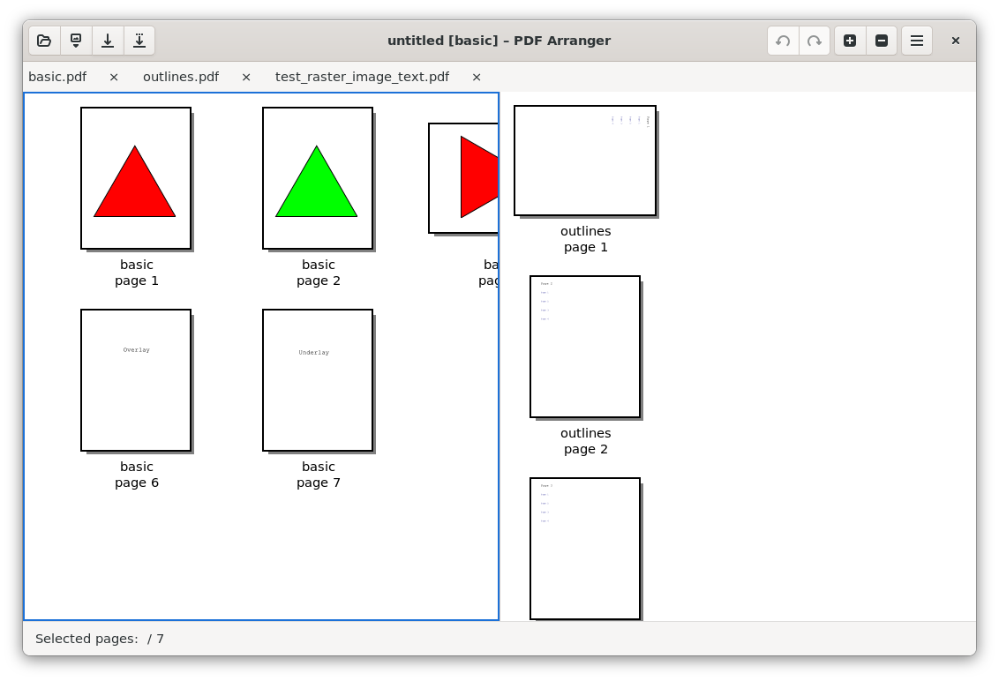
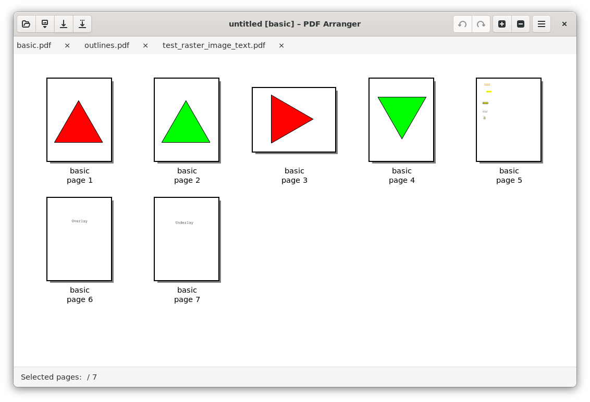

## About

[](https://github.com/pdfarranger/pdfarranger/actions?query=workflow%3ACodeQL "Code quality workflow status")
[](https://app.codacy.com/gh/pdfarranger/pdfarranger/dashboard)
[](https://github.com/pdfarranger/pdfarranger/actions?query=workflow%3Apdfarranger+branch%3Amain)
[](https://codecov.io/gh/pdfarranger/pdfarranger)

*PDF Arranger* is a small python-gtk application, which helps the user to merge
or split PDF documents and rotate, crop and rearrange their pages using an
interactive and intuitive graphical interface. It is a front end for
[pikepdf](https://github.com/pikepdf/pikepdf).

### What's New in the Latest Version: Tabbed Documents & Side-by-Side View
- **Tabbed Interface:** Work on multiple documents simultaneously in a single application window with a convenient tab strip (`Ctrl+T`, `Ctrl+W`, `Ctrl+Tab`).
- **Two-Pane Side-by-Side View:** Compare documents and arrange pages side-by-side (`View` → `Side by Side`), with an active blue border indicator and `F6` pane focus switching.
- **Cross-Document Drag and Drop:** Drag pages between open tabs or between side-by-side panes (Move by default, `Ctrl`+Drag to Copy).
- **Detachable Windows:** Drag tabs out to create new windows or move tabs across windows within a single unified process.
- **Isolated Document State:** Independent undo/redo history, zoom levels, and find/search queries (`Ctrl+F`) per document.

*PDF Arranger* is a fork of Konstantinos Poulios’s PDF-Shuffler
(see [Savannah](https://savannah.nongnu.org/projects/pdfshuffler) or
[Sourceforge](http://sourceforge.net/projects/pdfshuffler)).
It’s a humble attempt to make the project a bit more active.

For more info see [User Manual](https://github.com/pdfarranger/pdfarranger/wiki/User-Manual) and [ROADMAP.md](ROADMAP.md).

### Screenshots

#### Two-Pane Side-by-Side View
*Side-by-side comparison and cross-document editing with active pane outline (`#1c71d8`):*


#### Tabbed Document Interface
*Multiple PDF documents organized in tabs with unsaved indicators and independent search:*


#### Single Document View


### Key Shortcuts

| Shortcut | Action |
| --- | --- |
| `Ctrl+T` | Open a new empty tab |
| `Ctrl+W` | Close the active tab / document |
| `Ctrl+Tab` | Cycle to next tab |
| `Ctrl+Shift+Tab` | Cycle to previous tab |
| `F6` | Toggle active pane focus in Side-by-Side view |
| `Ctrl+N` | Open a new window |
| `Ctrl+O` | Open PDF files (fills empty document or opens into a new tab) |
| `Ctrl+I` | Import PDF / images into the focused document |
| `Ctrl+F` | Find / search text in the active document |
| `Ctrl+S` | Save current document |
| `Ctrl+Shift+S` | Save document as... |
| `Ctrl+Z` / `Ctrl+Y` | Undo / Redo edits in current document |
| `Ctrl+Q` | Quit application (with orderly save prompts) |

## Downloads

| [PDF Arranger for Windows](https://github.com/pdfarranger/pdfarranger/releases) | <a href='https://flathub.org/apps/details/com.github.jeromerobert.pdfarranger'></a> | <a href="https://snapcraft.io/pdfarranger"></a> | [More…](https://github.com/pdfarranger/pdfarranger/wiki/Binary-packages) |
| --------------------------------------------------------------------------- | -------------------------------------------------------------------------------------------------------------------------------------------------------------------------------------------- | ------------------------------------------------------------------------- | ------------------------------------------------------------------------- |


### Linux and BSD packages

[](https://repology.org/project/pdfarranger/versions)

## Install from source

*PDF Arranger* requires [pikepdf](https://github.com/pikepdf/pikepdf) >= 6.
Pip will automatically install the latest pikepdf if there is no pikepdf installed on the system.

**On Debian-based distributions**

```
sudo apt-get install python3-pip python3-wheel python3-gi python3-gi-cairo \
    gir1.2-gtk-3.0 gir1.2-poppler-0.18 gir1.2-handy-1 python3-setuptools \
    gettext python3-dateutil python3-venv
```

**On Arch Linux**

```
sudo pacman -S poppler-glib python-pip python-gobject gtk3 python-cairo libhandy
```

**On Fedora**

```
sudo dnf install poppler-glib python3-pip python3-gobject gtk3 python3-cairo \
    python3-wheel python3-pikepdf python3-img2pdf python3-dateutil libhandy
```

**On FreeBSD**

```
sudo pkg install devel/gettext devel/py-gobject3 devel/py-pip \
    graphics/poppler-glib textproc/py-pikepdf x11-toolkits/gtk30 \
    x11-toolkits/libhandy
```

**Install PDF Arranger in a virtual environment**

Create a virtual environment in `/home/user/myenv`
```
python3 -m venv --system-site-packages ~/myenv
```

Install PDF Arranger

```
~/myenv/bin/pip3 install --upgrade https://github.com/pdfarranger/pdfarranger/zipball/main
```

Optionally create a symlink so that the app can be started from anywhere in a terminal with `pdfarranger`

```
sudo ln -s ~/myenv/bin/pdfarranger /usr/local/bin/pdfarranger
```

In addition, *PDF Arranger* supports image file import if [img2pdf](https://gitlab.mister-muffin.de/josch/img2pdf) is installed.

## For developers

```
git clone https://github.com/pdfarranger/pdfarranger.git
cd pdfarranger
./setup.py build
python3 -m pdfarranger
```

For testing see [TESTING.md](TESTING.md).

For Windows see [Win32.md](Win32.md).

For macOS see [macOS.md](macOS.md).

### Repository Structure

```
.
|-- COPYING
|-- README.md
|-- ROADMAP.md
|-- TESTING.md
|-- Win32.md
|-- macOS.md
|-- data/
|   |-- com.github.jeromerobert.pdfarranger.desktop
|   |-- com.github.jeromerobert.pdfarranger.metainfo.xml
|   |-- menu.ui
|   |-- pdfarranger.ico
|   |-- pdfarranger.ui
|   |-- screenshot-side-by-side.png
|   |-- screenshot-tabs.png
|   \-- screenshot.png
|-- doc/
|   \-- pdfarranger.1
|-- docs/
|   |-- artifacts/
|   |   |-- tasks/
|   |   \-- walkthroughs/
|   \-- superpowers/
|       |-- plans/
|       \-- specs/
|-- pdfarranger/
|   |-- __init__.py
|   |-- __main__.py
|   |-- config.py
|   |-- core.py
|   |-- document.py
|   |-- exporter.py
|   |-- exporter_outlines.py
|   |-- iconview.py
|   |-- image_exporter.py
|   |-- metadata.py
|   |-- pageutils.py
|   |-- pdfarranger.py
|   |-- search.py
|   |-- session.py
|   |-- splitter.py
|   |-- undo.py
|   |-- win32ipc.py
|   \-- window.py
|-- setup.py
|-- setup_win32.py
|-- snapcraft.yaml
\-- tests/
    |-- exporter/
    |-- test.py
    |-- test_core.py
    |-- test_exporter.py
    \-- test_session.py
```


## For translators

Translations are located in the following files:

*   [`po`](po)`/LANG.po` for interface translation strings
*   [data/com.github.jeromerobert.pdfarranger.metainfo.xml](data/com.github.jeromerobert.pdfarranger.metainfo.xml) for repository integration
*   [data/com.github.jeromerobert.pdfarranger.desktop](data/com.github.jeromerobert.pdfarranger.desktop) for desktop integration
*   [config.py](pdfarranger/config.py) `LANGUAGE_NAMES` for native language name in preferences drop-down list

If you are not comfortable working with git, **you may edit translations directly from Github's web interface**. However, in the normal case
you would contribute translations by following these steps:

*   Download the main branch (see [For developers](#for-developers))
*   Checkout a new branch to save your changes: `git checkout -b update-translation-LANG`
*   Run `po/updatepo.sh LANG`, where `LANG` is the locale you'd like to update
*   Update your translations in `po/LANG.po` file, and commit them; do not commit changes to `po/pdfarranger.pot` which may have been
    automatically regenerated
*   If possible, test your translation to see it in context (see [For developers](#for-developers))
*   Create a new pull request with your changes to the main branch

If you are editing mnemonics accelerators (letters preceded by an underscore), here are some additional guidelines. However, if you have no idea what this means, don't worry about it.
Try to follow these rules by priority order:

*   be consistent with other GTK/GNOME software
*   pick a unique letter **within that given menu** if possible
*   pick the same letter as the original string if available
*   pick a strong letter (e.g. in "Search and replace" rather pick `s`, `r` or `p` than `a`)
